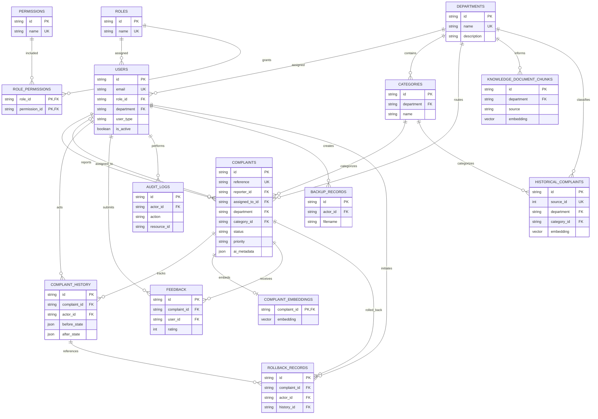

# CampusCare Entity-Relationship Diagram

This diagram reflects the current application models in
[`backend/models.py`](../../backend/models.py), not the legacy integer-ID schema
on the separate GitHub `database` branch.

