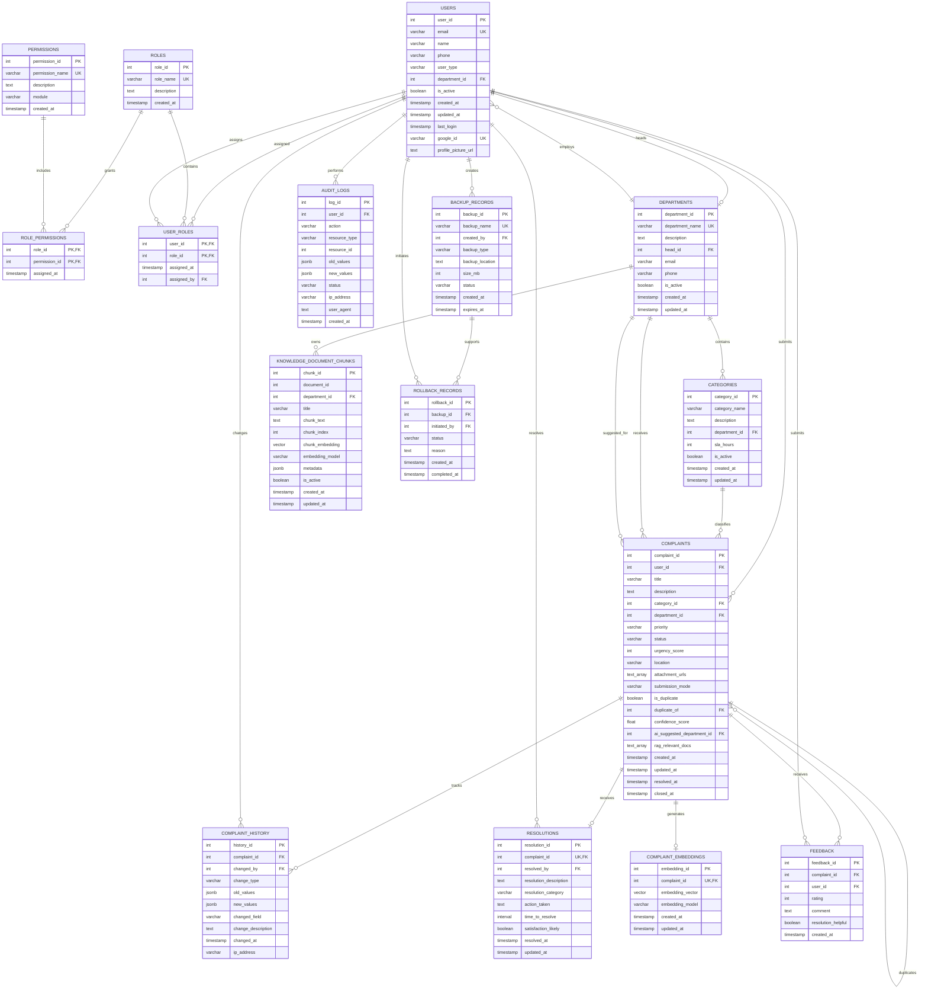

# Entity-Relationship Diagram

This diagram represents the finalized PostgreSQL database schema for the AI
Smart Complaint Routing system. Department handling is represented via `department_id` and `status`, without a separate assignment table.



## Main Relationship Flow

```text
USER -> COMPLAINT -> ASSIGNMENT -> OFFICER
                  -> COMPLAINT_HISTORY
                  -> RESOLUTION
                  -> FEEDBACK
                  -> COMPLAINT_EMBEDDING

DEPARTMENT -> CATEGORY -> COMPLAINT
DEPARTMENT -> KNOWLEDGE_DOCUMENT_CHUNKS

USER -> ROLE -> PERMISSION
BACKUP_RECORD -> ROLLBACK_RECORD
```

The diagram can be rendered by GitHub and viewed in Mermaid-compatible tools
such as Mermaid Live Editor.

In this version, status changes like `ASSIGNED` and `IN_PROGRESS` are tracked on the complaint record itself.
`n> Manual workflow note: department and status are the active tracking fields; assignment is a dashboard action, not a database entity.`n